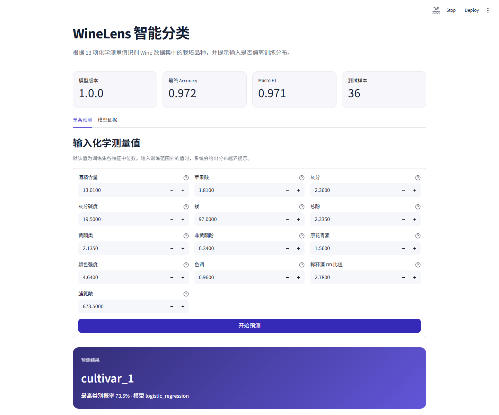
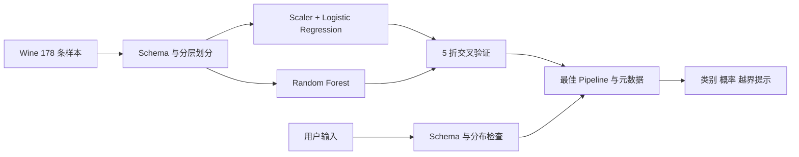

# Wine 智能分类系统

基于 scikit-learn Pipeline 和 Streamlit 的葡萄酒品种三分类应用。系统比较两种算法、保存最佳完整 Pipeline，并对偏离训练分布的输入给出风险提示。

作者：侯宇晴（23120506154，软件2304）



## 功能

- 使用内置 Wine 数据完成可复现的分层训练和测试划分
- 在相同 5 折交叉验证协议下比较逻辑回归和随机森林
- 报告 Accuracy、macro Precision、Recall、F1、标准差和混淆矩阵
- 保存完整 Pipeline、模型版本、Schema、训练统计和 SHA256
- Streamlit 表单实时预测三个品种类别并展示类别概率
- 拒绝缺失、未知、非数字、无穷大和明显越界输入
- 自主功能：按训练范围与 IQR 识别分布越界，分级提示可靠性风险

## 模型结果

| 模型 | CV Accuracy | CV Precision | CV Recall | CV Macro F1 | F1 标准差 |
|---|---:|---:|---:|---:|---:|
| 逻辑回归 | 0.9791 | 0.9789 | 0.9828 | **0.9796** | 0.0273 |
| 随机森林 | 0.9791 | 0.9785 | 0.9828 | 0.9789 | 0.0285 |

主指标为 macro F1。逻辑回归的均值略高，因此被选为最终模型。模型选择只使用训练集交叉验证；36 条测试样本仅评价一次，结果如下：

- Accuracy：0.9722
- Macro Precision：0.9778
- Macro Recall：0.9667
- Macro F1：0.9710
- 混淆矩阵：`[[12, 0, 0], [0, 14, 0], [0, 1, 9]]`

## 系统架构



预处理和估计器位于同一个 Pipeline。StandardScaler 只在训练折内拟合，最终测试集不参与选模。应用从磁盘加载固定模型，不会在用户点击时重新训练。

## 环境安装

推荐 Python 3.12。仓库已经固定主要依赖版本。

```powershell
python --version
python -m venv .venv
.\.venv\Scripts\Activate.ps1
python -m pip install --timeout 120 -r requirements.txt
```

## 启动应用

仓库已经包含训练后的模型，可以直接运行：

```powershell
.\scripts\start.ps1
```

浏览器访问 <http://127.0.0.1:8502>。应用启动时会核对模型 SHA256；哈希不一致时拒绝加载。

## 最小 Demo

1. 打开“单条预测”，保留 13 项训练中位数，点击“开始预测”。
2. 页面应返回 `cultivar_1`、类别概率和“未发现分布越界”。
3. 将酒精含量调到训练最大值以上，再次预测，页面会显示黄色越界提示。
4. 再把苹果酸调到训练最大值以上，页面会显示高风险红色提示。
5. 打开“模型证据”，查看两模型比较表、最终混淆矩阵、模型 Commit 和 SHA256。

## 重新训练

```powershell
.\scripts\train.ps1
```

训练会覆盖以下文件：

- `models/wine_pipeline.joblib`：最佳完整 Pipeline
- `models/model_meta.json`：版本、Schema、标签、训练统计、测试指标和哈希
- `models/evaluation.json`：两模型交叉验证结果和最终测试证据

如果数据、特征、标签或 scikit-learn 主版本变化，必须重新训练并同步提交三个文件。

## 测试

```powershell
.\.venv\Scripts\python.exe -m pytest -q
```

当前结果为 27 项通过、0 项失败。覆盖 6 项数据与划分检查、模型比较与最终评价、Pipeline Schema 和保存加载、6 项 Streamlit 应用测试，以及 4 项以上分布越界功能测试。完整记录见 [测试说明](docs/TESTING.md)。

## 数据和 Schema

数据通过 `sklearn.datasets.load_wine(as_frame=True)` 离线加载，共 178 行、13 个连续数值特征和 3 类。固定 `random_state=42`，使用分层 80/20 划分。训练集用于 5 折分层交叉验证，测试集只做最终一次评价。

应用要求以下 13 列，名称与模型元数据完全一致：

`alcohol`、`malic_acid`、`ash`、`alcalinity_of_ash`、`magnesium`、`total_phenols`、`flavanoids`、`nonflavanoid_phenols`、`proanthocyanins`、`color_intensity`、`hue`、`od280/od315_of_diluted_wines`、`proline`。

数据来源、样本单位、许可和划分说明见 [data/README.md](data/README.md)，用途和风险见 [model_card.md](model_card.md)。

## 自主功能说明

用户的问题是：模型即使面对从未见过的化学测量组合，也可能给出看似很高的概率。应用因此保存训练集每项特征的最小值、最大值和四分位数，并在推理前执行两级检查：

- 单项超出训练范围或位于 IQR 尾部时显示中等风险提示。
- 至少两项超出训练范围，或四项以上位于尾部时显示高风险提示。
- 超过训练跨度一倍的极端值直接拒绝，避免无意义推理。

27 项测试中的正常、中风险、高风险和极端拒绝用例给出了可重复证据。这只是经验性输入监控，不等同于正式的统计漂移检验。

## 二次开发范围

scikit-learn 和 Streamlit 是上游开源库，不是可直接换名提交的网站。本人完成了任务定义、分层划分、两模型 Pipeline、评价与选模、模型保存和哈希、输入校验、分布越界规则、Streamlit 应用、自动化测试及交付文档。

## Git 开发证据

仓库使用 `main` 保存数据与依赖基线，`feature/model-application` 保存功能开发。提交依次覆盖基线、训练 Pipeline、模型证据、推理应用、测试和文档。Issue 定义越界提示的用户价值与验收条件，PR 合并前按 [自我审查记录](docs/SELF_REVIEW.md) 完成审查。

```powershell
git log --oneline --graph --decorate --all -n 30
git shortlog -sne HEAD
```

## 安全与限制

- 只加载仓库内由本人训练且哈希匹配的 joblib 文件。joblib 可能执行代码，不接受用户上传模型。
- 模型只能用于课程演示，不能用于食品安全、商业定价、产地认证或真实质量判断。
- 数据集规模小，来自特定研究场景；高预测概率不代表事实确定性。
- 当前越界判断针对单条输入；生产系统还需监控时间窗口内的整体分布变化。
- scikit-learn 模型不承诺跨主版本反序列化，版本变化应重新训练。

## 开源来源

scikit-learn 1.7.2（BSD-3-Clause）、Streamlit 1.50.0（Apache-2.0）和 Wine 数据集（UCI，CC BY 4.0）。完整归因见 [NOTICE.md](NOTICE.md)，本仓库原创代码使用 [MIT License](LICENSE)。

